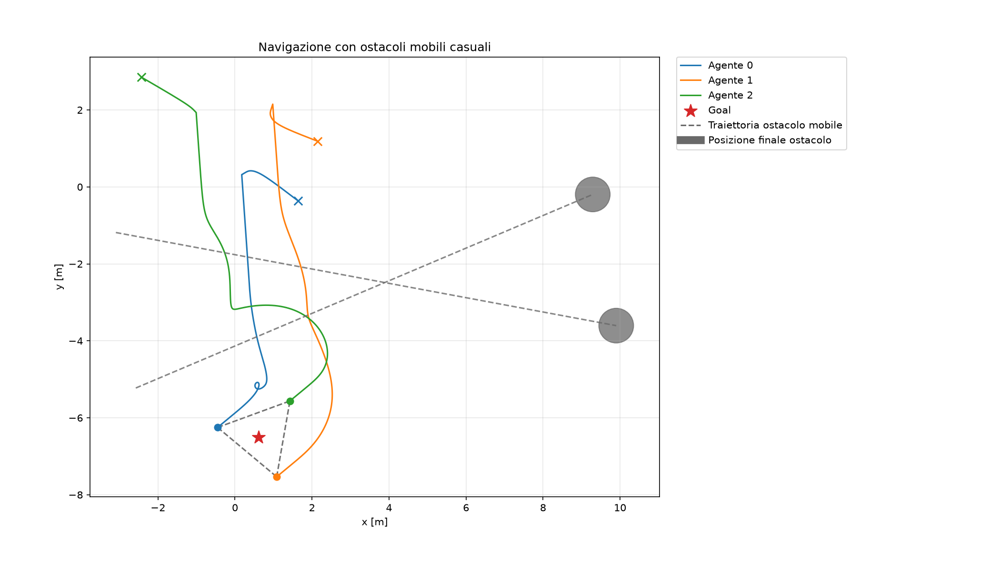
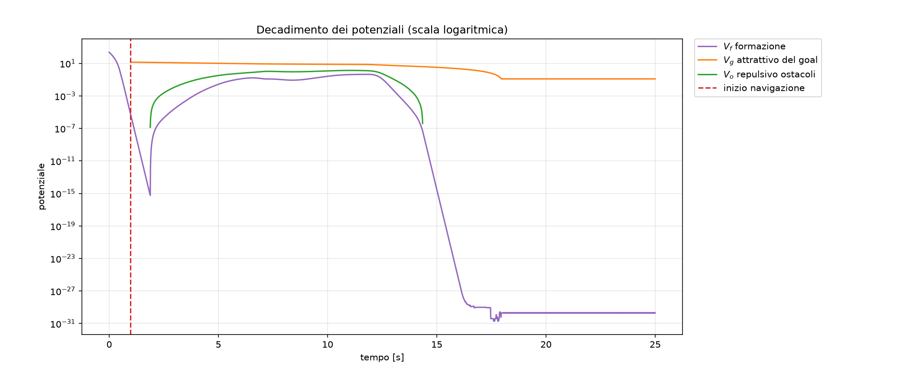
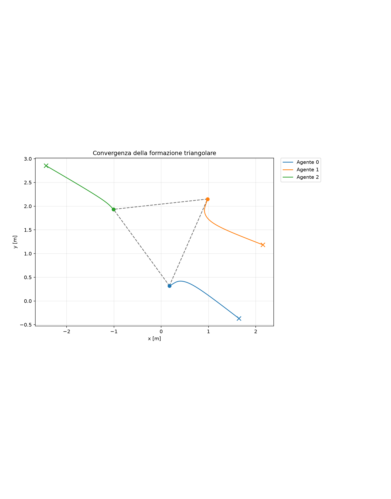
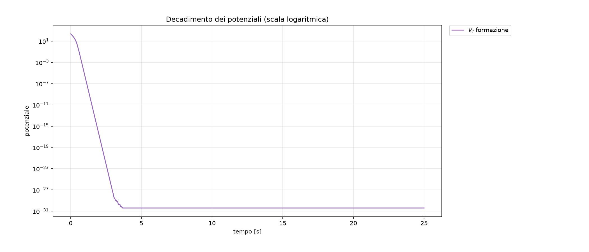
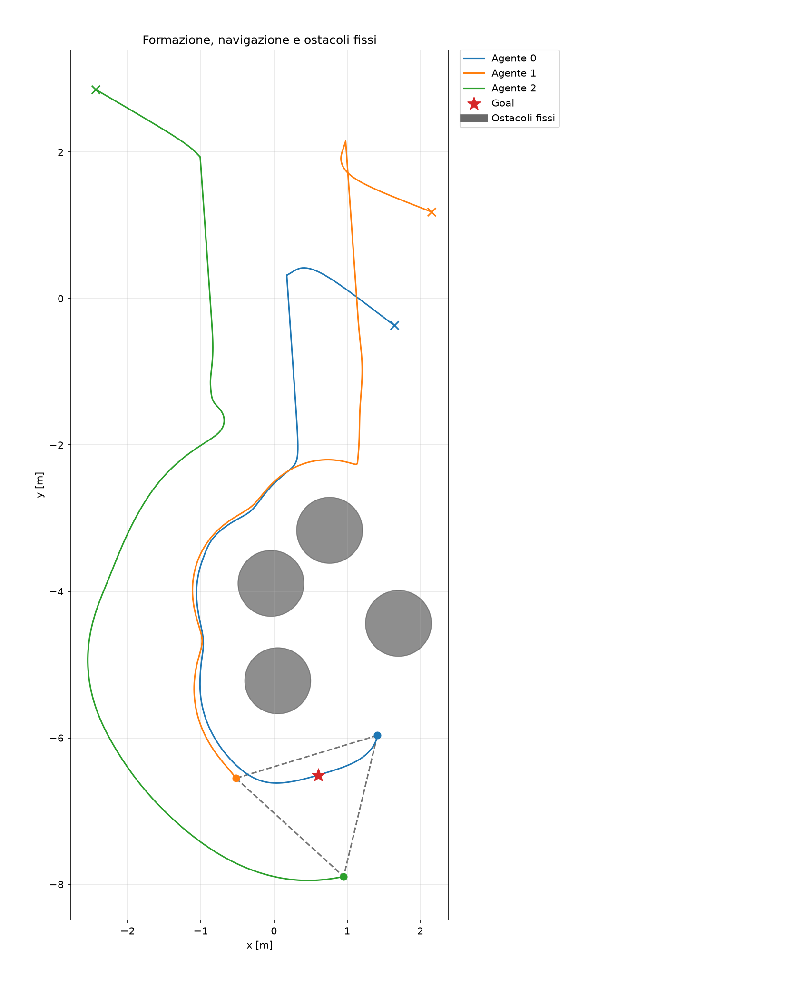
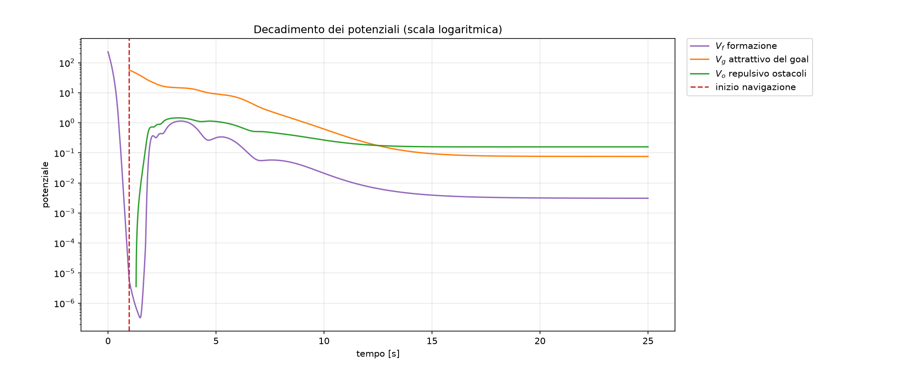
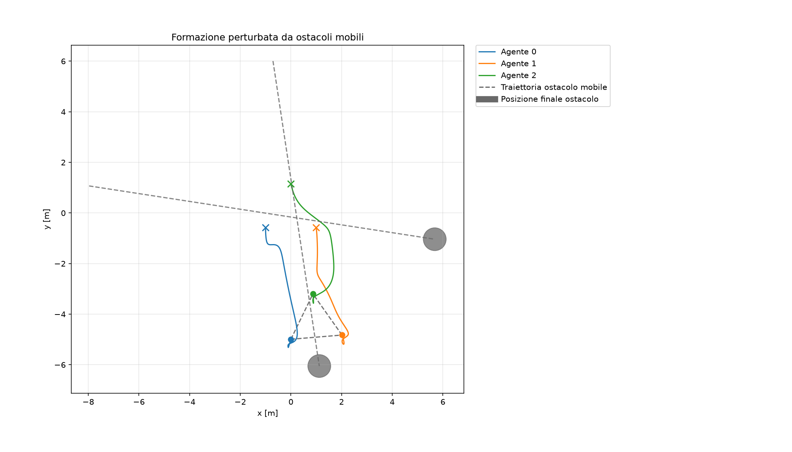
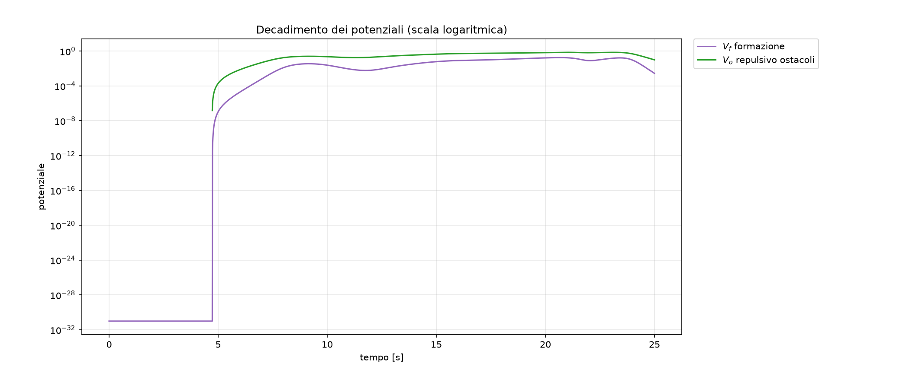

# Controllo di formazione e navigazione di un sistema multi-agente

**Simulazione planare con dinamica a singolo integratore, formazione triangolare rigida e campi di potenziale artificiali per ostacoli statici e mobili.**

Il progetto studia l'interazione fra tre obiettivi di controllo: mantenimento delle distanze relative, navigazione del baricentro verso un obiettivo e repulsione dagli ostacoli. Gli esperimenti permettono di analizzare sia il comportamento nominale sia deformazioni della formazione ed equilibri indesiderati.

La versione corrente costituisce una **baseline APF reattiva**: gli ostacoli possono muoversi, ma il controllo repulsivo utilizza solo la loro posizione istantanea. Un potenziale predittivo dipendente dalla velocità non è ancora implementato.

## Indice

- [1. Risultati sperimentali](#1-risultati-sperimentali)
- [2. Esplorazione interattiva](#2-esplorazione-interattiva)
- [3. Installazione e avvio](#3-installazione-e-avvio)
- [4. Modello matematico](#4-modello-matematico)
- [5. Formazione e leggi di controllo](#5-formazione-e-leggi-di-controllo)
- [6. Scenari e parametri](#6-scenari-e-parametri)
- [7. Architettura e dati registrati](#7-architettura-e-dati-registrati)
- [8. Verifica e interpretazione dei risultati](#8-verifica-e-interpretazione-dei-risultati)
- [9. Limiti e sviluppi futuri](#9-limiti-e-sviluppi-futuri)

## 1. Risultati sperimentali

### Navigazione con ostacoli mobili

Tre agenti raggiungono la formazione desiderata e successivamente navigano verso un goal. Due ostacoli percorrono traiettorie rettilinee con condizioni iniziali e velocità estratte casualmente.

[](docs/results/dynamic_navigation_trajectories.png)

*Figura 1 — Le croci identificano le posizioni iniziali degli agenti; i punti colorati quelle finali. Il triangolo tratteggiato rappresenta la formazione finale, la stella rossa il goal e i dischi grigi gli ostacoli alla fine della simulazione. Le tracce grigie descrivono il loro moto, non la presenza di ostacoli fissi lungo l'intero percorso.*

[](docs/results/dynamic_navigation_potentials.png)

*Figura 2 — La repulsione provoca una deformazione transitoria della formazione. All'allontanarsi degli ostacoli, il contributo repulsivo si annulla e il potenziale di formazione torna a valori prossimi alla precisione numerica. Il potenziale del goal non raggiunge necessariamente zero, poiché la navigazione si arresta entro una tolleranza di arrivo.*

**Riproduzione dell'esperimento illustrato:**

```bash
.venv/bin/python main.py \
  --experiment dynamic-navigation \
  --moving-obstacle-count 2 \
  --seed 42 --dt 0.01 --duration 25 \
  --save docs/results/dynamic_navigation.png \
  --export-html docs/interactive/dynamic_navigation.html
```

Per questa esecuzione, la navigazione si attiva a circa **0.98 s** e la distanza finale fra baricentro e goal è circa **0.0999 m**, inferiore alla tolleranza di **0.1 m**. Questi valori descrivono un caso sperimentale, non una garanzia di convergenza per ogni configurazione.

### Altri scenari

Le figure seguenti sono generate con `seed=42`, passo `0.01 s` e durata `25 s`. Le immagini possono essere aperte singolarmente per esaminarne i dettagli.

<details>
<summary><strong>Formazione senza navigazione né ostacoli</strong></summary>





Il sistema converge verso un triangolo equilatero di lato 2 m. La posizione e l'orientamento assoluti non sono assegnati dal controllo a distanze.

```bash
.venv/bin/python main.py --experiment formation --seed 42 --duration 25 \
  --save docs/results/formation.png
```

</details>

<details>
<summary><strong>Navigazione con quattro ostacoli statici</strong></summary>





In questa esecuzione la distanza finale dal goal è circa 0.291 m: il criterio di arrivo non è soddisfatto alla fine della simulazione. I residui dei potenziali evidenziano la competizione fra mantenimento della forma, attrazione e repulsione. Un andamento quasi costante suggerisce un equilibrio indesiderato; dimostrare che si tratti di un minimo locale richiede ulteriori verifiche del campo di controllo e della stabilità.

```bash
.venv/bin/python main.py --experiment static-obstacles --obstacle-count 4 \
  --seed 42 --duration 25 --save docs/results/static_obstacles.png
```

</details>

<details>
<summary><strong>Formazione senza goal perturbata da due ostacoli mobili</strong></summary>





Gli agenti partono già in formazione e non ricevono un comando di navigazione. La repulsione può tuttavia traslare e ruotare il gruppo: non è previsto un vincolo che riporti il baricentro o l'orientamento al valore iniziale. Il recupero riguarda le distanze relative.

```bash
.venv/bin/python main.py --experiment moving-obstacles --moving-obstacle-count 2 \
  --seed 42 --duration 25 --save docs/results/moving_obstacles.png
```

</details>

## 2. Esplorazione interattiva

### 2.1 Pagina HTML con slider e riproduzione

È disponibile una [simulazione interattiva esportata in HTML](docs/interactive/dynamic_navigation.html), relativa all'esperimento delle Figure 1–2. La pagina include:

- slider su **tutti i timestep registrati**, senza ricampionamento;
- riproduzione e pausa, con velocità selezionabile;
- posizioni istantanee, storia delle traiettorie e archi della formazione;
- ostacoli mobili e comparsa del goal all'attivazione della navigazione;
- valori istantanei dei potenziali.

**GitHub non esegue JavaScript nel README né nella normale anteprima dei file HTML.** Il collegamento permette di individuare il documento nel repository: per usare lo slider, scaricare il file e aprirlo nel browser, oppure servirlo localmente:

```bash
.venv/bin/python -m http.server 8000 --directory docs
```

Aprire quindi <http://localhost:8000/interactive/dynamic_navigation.html>.

Il documento è autonomo e non richiede Python, librerie JavaScript esterne o una connessione Internet durante la visualizzazione. Può inoltre essere pubblicato come pagina statica tramite GitHub Pages, configurando `docs/` come cartella di pubblicazione. La pubblicazione non viene effettuata automaticamente dal progetto.

Per esportare una nuova simulazione senza aprire finestre grafiche:

```bash
.venv/bin/python main.py \
  --experiment dynamic-navigation --moving-obstacle-count 2 --seed 42 \
  --export-html outputs/simulation.html --no-plot
```

### 2.2 Slider nella finestra Matplotlib

È disponibile anche la visualizzazione interattiva locale:

```bash
.venv/bin/python main.py \
  --experiment dynamic-navigation --moving-obstacle-count 2 --seed 42 \
  --interactive
```

Questa modalità richiede un backend grafico interattivo di Matplotlib. Non genera un file HTML e non è una registrazione video: permette di esplorare gli stati già simulati mediante uno slider.

## 3. Installazione e avvio

### Requisiti

- Python **3.10 o superiore**;
- NumPy per il calcolo numerico;
- Matplotlib per grafici e slider locale;
- pytest per i test automatici.

Le dipendenze sono definite in `pyproject.toml`.

```bash
python3 -m venv .venv
.venv/bin/python -m pip install --upgrade pip
.venv/bin/python -m pip install -e '.[dev]'
```

Su Windows, sostituire `.venv/bin/python` con `.venv\Scripts\python.exe`.

```bash
# Esperimento predefinito: navigazione con tre ostacoli statici
.venv/bin/python main.py --seed 42

# Opzioni disponibili
.venv/bin/python main.py --help

# Test
.venv/bin/python -m pytest -q
```

## 4. Modello matematico

Le formule utilizzano la notazione matematica supportata da GitHub, con espressioni in linea e blocchi LaTeX separati. Per una corretta lettura in editor locali è necessario un visualizzatore Markdown con supporto matematico.

### 4.1 Notazione e ipotesi

- $N=3$: numero di agenti; $M$: numero di ostacoli.
- $p_i\in\mathbb{R}^2$: posizione del centro dell'agente $i$.
- $q_j\in\mathbb{R}^2$: posizione del centro dell'ostacolo $j$.
- $r_i$ e $R_j$: raggi fisici, rispettivamente di agente e ostacolo.
- $u_i\in\mathbb{R}^2$: comando di velocità richiesto all'agente.
- $v_j\in\mathbb{R}^2$: velocità costante dell'ostacolo.
- $g\in\mathbb{R}^2$: goal del baricentro; $c$: baricentro del MAS.
- $d_{ij}$: distanza desiderata tra gli agenti collegati dall'arco $(i,j)$.

Si assumono posizioni note senza rumore, attuazione di velocità senza dinamica interna, comunicazione ideale e aggiornamento sincrono. La simulazione usa metri e secondi come unità di riferimento.

### 4.2 Dinamica degli agenti e saturazione

Il modello a singolo integratore è:

$$
\dot p_i(t)=\bar u_i(t), \qquad i=1,\ldots,N,
$$

dove il comando applicato $\bar u_i$ è ottenuto saturando il comando richiesto:

$$
\bar u_i=\operatorname{sat}_{u_{\max,i}}(u_i)=
\begin{cases}
u_i, & \lVert u_i\rVert\leq u_{\max,i},\\
u_{\max,i}\dfrac{u_i}{\lVert u_i\rVert}, & \lVert u_i\rVert>u_{\max,i}.
\end{cases}
$$

La velocità non è uno stato dinamico indipendente: coincide con il controllo applicato. In tutti gli esperimenti la velocità massima degli agenti è impostata a $3\,\mathrm{m/s}$.

### 4.3 Dinamica degli ostacoli

$$
\dot q_j(t)=v_j, \qquad q_j(t)=q_j(0)+t\,v_j.
$$

Il caso statico corrisponde a $v_j=0$. Negli scenari dinamici vengono estratte condizioni iniziali casuali, ma **direzione e velocità restano costanti durante ogni esecuzione**: non si tratta di un moto browniano o di cambiamenti casuali di direzione ad ogni passo.

### 4.4 Discretizzazione e aggiornamento sincrono

Con passo temporale $\Delta t>0$:

$$
\begin{aligned}
p_i[k+1]&=p_i[k]+\Delta t\,\bar u_i[k],\\
q_j[k+1]&=q_j[k]+\Delta t\,v_j.
\end{aligned}
$$

Tutti i comandi sono calcolati sullo stato al tempo $k$ prima di aggiornare le entità. La durata deve essere un multiplo intero di $\Delta t$. Un passo troppo grande può compromettere stabilità numerica e sicurezza, soprattutto vicino agli ostacoli.

## 5. Formazione e leggi di controllo

### 5.1 Grafo delle distanze e rigidità

La formazione è definita dal grafo non orientato completo $K_3$:

$$
\mathcal V=\{0,1,2\}, \qquad
\mathcal E=\{(0,1),(0,2),(1,2)\}.
$$

I vincoli desiderati sono:

$$
\lVert p_i-p_j\rVert=d_{ij}, \qquad (i,j)\in\mathcal E.
$$

Le tre distanze devono essere positive e soddisfare le disuguaglianze strette del triangolo:

$$
\begin{aligned}
d_{01}+d_{02}&>d_{12},\\
d_{01}+d_{12}&>d_{02},\\
d_{02}+d_{12}&>d_{01}.
\end{aligned}
$$

Una realizzazione non degenere è rigida nel piano. I vincoli non assegnano posizione assoluta, orientamento o chiralità: configurazioni traslate, ruotate o riflesse soddisfano le stesse distanze.

```python
from mas_formation.models import TriangularFormation

formation = TriangularFormation.from_desired_distances(
    agent_ids=(0, 1, 2),
    desired_distances={(0, 1): 2.0, (0, 2): 2.0, (1, 2): 2.0},
)
```

Sono disponibili anche `equilateral(...)` e `from_reference_positions(...)`. Quest'ultimo ricava le distanze da una geometria di riferimento, senza imporre tali coordinate come destinazioni assolute.

### 5.2 Potenziale e controllo distribuito di formazione

Si definisce il potenziale quartico:

$$
V_f(p)=\frac{k_f}{4}\sum_{(i,j)\in\mathcal E}
\left(\lVert p_i-p_j\rVert^2-d_{ij}^2\right)^2.
$$

Ogni arco è contato una sola volta. Il comando locale è:

$$
\begin{aligned}
u_{f,i}&=-\nabla_{p_i}V_f\\
&=-k_f\sum_{j\in\mathcal N_i}
\left(\lVert p_i-p_j\rVert^2-d_{ij}^2\right)(p_i-p_j).
\end{aligned}
$$

Il controllo è attrattivo quando una distanza supera quella desiderata e repulsivo quando è inferiore. Per il calcolo locale servono soltanto posizione propria e posizioni dei vicini nel grafo.

Nel caso ideale continuo con il solo controllo di formazione, senza saturazione:

$$
\dot V_f=-\sum_{i=1}^N\lVert\nabla_{p_i}V_f\rVert^2\leq0.
$$

Questa proprietà non costituisce una dimostrazione di convergenza globale verso la formazione desiderata: possono esistere altri punti critici. Inoltre, la discretizzazione richiede una scelta appropriata del passo temporale.

### 5.3 Potenziale di navigazione del baricentro

$$
c=\frac{1}{N}\sum_{i=1}^Np_i, \qquad
V_g(p)=\frac{k_gN}{2}\lVert c-g\rVert^2.
$$

Il fattore $N$ rende il gradiente rispetto a ogni posizione coerente con il comando comune:

$$
u_{g,i}=-\nabla_{p_i}V_g=k_g(g-c).
$$

Il solo comando di navigazione non modifica le distanze relative, prima della saturazione, perché:

$$
u_{g,i}-u_{g,j}=0.
$$

La navigazione si attiva al primo istante $t_a$ in cui:

$$
\max_{(i,j)\in\mathcal E}
\left|\lVert p_i-p_j\rVert-d_{ij}\right|\leq\varepsilon_f.
$$

Il goal è costruito una sola volta:

$$
g=c(t_a)+d_g\begin{bmatrix}\cos\theta\\\sin\theta\end{bmatrix},
\qquad \theta\sim\mathcal U([0,2\pi)).
$$

Negli esperimenti con ostacoli l'angolo viene estratto prima dell'avvio per costruire scenari di interazione significativi; le coordinate del goal sono comunque fissate rispetto al baricentro al momento dell'attivazione.

Dopo l'attivazione, la navigazione non viene nuovamente disabilitata se la formazione si deforma. Il termine attrattivo si annulla quando:

$$
\lVert c-g\rVert\leq\varepsilon_g.
$$

Il controllo di formazione e l'evitamento rimangono attivi. Se una perturbazione porta nuovamente il baricentro fuori dalla regione di arrivo, il comando verso il goal riprende.

> Il controllo di formazione è distribuito sul grafo. Il controllo di navigazione, nell'implementazione corrente, usa invece il baricentro calcolato dallo stato globale; non è implementato un estimatore distribuito del baricentro.

### 5.4 Potenziale repulsivo degli ostacoli

La distanza fra i bordi è detta *clearance*:

$$
\rho_{ij}=\lVert p_i-q_j\rVert-r_i-R_j.
$$

Per $\rho_{ij}>0$, il potenziale ideale è:

$$
V_{o,ij}=
\begin{cases}
\dfrac{k_o}{2}\left(\dfrac{1}{\rho_{ij}}-\dfrac{1}{\rho_0}\right)^2,
&0<\rho_{ij}<\rho_0,\\
0,&\rho_{ij}\geq\rho_0.
\end{cases}
$$

Il potenziale repulsivo totale somma tutte le coppie agente–ostacolo:

$$
V_o(p,q)=\sum_{i=1}^{N}\sum_{j=1}^{M}V_{o,ij}.
$$

Indicando con $\mathcal O_i=\{j:0<\rho_{ij}<\rho_0\}$ gli ostacoli influenti, il comando nel dominio non regolarizzato è:

$$
u_{o,i}=-\nabla_{p_i}V_o
=\sum_{j\in\mathcal O_i}k_o
\left(\frac{1}{\rho_{ij}}-\frac{1}{\rho_0}\right)
\frac{p_i-q_j}{\rho_{ij}^2\lVert p_i-q_j\rVert}.
$$

Il codice utilizza una clearance regolarizzata:

$$
\widetilde\rho_{ij}=\max(\rho_{ij},\rho_{\min}).
$$

Questa sostituzione mantiene finiti potenziale e comando vicino alla singolarità, anche in caso di compenetrazione. **Nella regione regolarizzata il campo applicato non coincide con il gradiente del potenziale troncato mostrato nei grafici.** La regolarizzazione non costituisce una garanzia di non collisione. In caso di coincidenza esatta dei centri il codice assegna una direzione repulsiva convenzionale.

Nei test con ostacoli:

$$
\rho_0=2.0\,\mathrm{m}, \qquad
r_i=0.15\,\mathrm{m}, \qquad
R_j=0.45\,\mathrm{m}.
$$

Pertanto il campo si attiva per distanze fra centri inferiori a:

$$
\lVert p_i-q_j\rVert<r_i+R_j+\rho_0=2.6\,\mathrm{m}.
$$

### 5.5 Composizione e significato dei potenziali

$$
u_i=u_{f,i}+u_{o,i}+\sigma\,u_{g,i},
\qquad \sigma\in\{0,1\}.
$$

Il supervisore mantiene $\sigma=0$ fino al raggiungimento della formazione e successivamente imposta $\sigma=1$; il controllore del goal applica inoltre la tolleranza di arrivo. Nei test senza goal, $u_{g,i}$ è assente. L'evitamento è attivo anche durante la formazione iniziale.

Nelle regioni non regolarizzate, con ostacoli statici, navigazione attiva fuori dalla regione di arrivo e senza saturazione, la legge è coerente con la discesa del potenziale $V_f+V_g+V_o$. Per ostacoli mobili, $V_o$ dipende esplicitamente dal tempo attraverso $q_j(t)$: **non è attesa una diminuzione monotona di ogni potenziale**, né del totale, durante una perturbazione esterna.

## 6. Scenari e parametri

| Esperimento | Condizione iniziale | Goal | Ostacoli |
|---|---|---|---|
| `formation` | Agenti in posizioni casuali | Assente | Assenti |
| `formation-goal` | Agenti in posizioni casuali | Casuale, attivato dopo la formazione | Assenti |
| `static-obstacles` | Agenti in posizioni casuali | Come sopra | Da 1 a 5 dischi fissi |
| `moving-obstacles` | Triangolo già in equilibrio | Assente | Da 1 a 3 dischi a velocità costante casuale |
| `dynamic-navigation` | Agenti in posizioni casuali | Casuale, attivato dopo la formazione | Da 1 a 3 dischi mobili su rette casuali |

Le condizioni iniziali casuali degli agenti sono estratte in `[-3, 3]²`, rifiutando configurazioni troppo ravvicinate o quasi collineari. Gli ostacoli mobili sono generati in modo da attraversare la zona della formazione o il corridoio previsto di navigazione: la distribuzione non è uniforme su tutto il piano e non garantisce un incontro per qualsiasi evoluzione del MAS. Non sono previsti rimbalzi ai bordi negli esperimenti correnti.

### Interfaccia a riga di comando

| Opzione | Significato | Default di `main.py` |
|---|---|---|
| `--experiment` | Scenario da eseguire | `static-obstacles` |
| `--dt` | Passo temporale in secondi | `0.01` |
| `--duration` | Durata in secondi | `25.0` |
| `--goal-distance` | Distanza goal–baricentro all'attivazione, in metri | `8.0` |
| `--obstacle-count` | Ostacoli statici, da 1 a 5 | `3` |
| `--moving-obstacle-count` | Ostacoli mobili, da 1 a 3 | `1` |
| `--seed` | Seed delle estrazioni casuali | Nessuno |
| `--save PATH` | Salva le due figure statiche | Nessuno |
| `--export-html PATH` | Esporta pagina autonoma con slider e riproduzione | Nessuno |
| `--no-plot` | Non apre le figure statiche | Disabilitato |
| `--interactive` | Mostra lo slider locale al posto dei grafici statici | Disabilitato |

`--save outputs/test.png` produce `outputs/test_trajectories.png` e `outputs/test_potentials.png`. Il salvataggio statico non viene eseguito con `--no-plot` o `--interactive`; `--export-html` è indipendente da entrambe le opzioni. Se presenti insieme, `--interactive` ha precedenza su `--no-plot` per la visualizzazione locale.

L'assenza di `--seed` produce scenari diversi ad ogni esecuzione. I valori CLI possono differire dai default delle funzioni richiamate direttamente dall'API Python: per confronti sperimentali è opportuno specificare esplicitamente tutti i parametri.

### Parametri dei controllori negli esperimenti

| Parametro | Valore |
|---|---|
| Lato del triangolo desiderato | 2 m |
| Guadagno di formazione `gain` | 1.0 |
| Guadagno di navigazione | 0.6; 0.3 in `dynamic-navigation` |
| Tolleranza sulle distanze per avviare la navigazione | 0.001 m |
| Tolleranza di arrivo del baricentro | 0.1 m |
| Guadagno repulsivo negli scenari con ostacoli | 0.3 |
| Distanza di influenza misurata fra i bordi | 2.0 m |
| Clearance minima di regolarizzazione | 0.05 m |

Questi parametri sono definiti nelle funzioni in `experiments/basic_formation.py`; non sono tutti esposti tramite CLI. Variando il numero di ostacoli o la distanza del goal si possono generare scenari sfavorevoli: non è garantito che la formazione iniziale venga raggiunta entro la durata assegnata. In tal caso gli esperimenti con navigazione segnalano un errore.

## 7. Architettura e dati registrati

```text
.
├── README.md
├── main.py
├── pyproject.toml
├── docs/
│   ├── results/                 # Figure riproducibili incluse nel README
│   └── interactive/             # Esportazioni HTML autonome
├── src/mas_formation/
│   ├── models/
│   │   ├── agent.py             # Dinamica e saturazione
│   │   ├── obstacle.py          # Disco statico o a velocità costante
│   │   ├── environment.py       # Aggiornamento sincrono
│   │   └── formation.py         # Grafo e vincoli di distanza
│   ├── controllers/
│   │   ├── formation.py         # Gradiente del potenziale di formazione
│   │   ├── navigation.py        # Navigazione del baricentro
│   │   ├── obstacle_avoidance.py
│   │   └── mission.py           # Composizione e supervisione
│   └── experiments/
│       ├── basic_formation.py   # Scenari, raccolta dati, grafici Matplotlib
│       └── html_viewer.py       # Esportazione interattiva per browser
├── tests/
└── outputs/                    # Risultati delle esecuzioni locali
```

`Environment` contiene agenti e ostacoli. Le leggi di controllo restano separate dai modelli dinamici. `FormationThenGoalController` gestisce la sequenza formazione–navigazione; `FormationWithObstacleAvoidanceController` combina formazione ed evitamento senza goal. `StaticObstacleAvoidanceController` limita gli ingressi a ostacoli immobili, mentre `PositionBasedObstacleAvoidanceController` ammette anche ostacoli mobili.

Le funzioni di esperimento restituiscono strutture dati con:

- `times`: vettore degli istanti registrati;
- `positions`: array con forma `(timestep, agente, coordinata)`;
- `potentials`: valori del potenziale di formazione;
- `goal`, `navigation_start_time`, `goal_potentials`: per gli scenari di navigazione;
- `obstacle_positions`: storia dei centri negli scenari dinamici;
- `obstacle_potentials`: repulsione totale negli scenari con ostacoli.

Prima dell'attivazione del goal, il relativo potenziale è rappresentato da `NaN` nei dati Python e da `null` nell'esportazione HTML. Le posizioni storiche degli ostacoli sono disponibili nell'array dedicato: gli oggetti `DynamicObstacle` contenuti nel risultato mantengono invece lo stato finale.

## 8. Verifica e interpretazione dei risultati

### Test automatici

```bash
.venv/bin/python -m pytest -q
```

La suite verifica dinamiche, saturazione, aggiornamento sincrono, validazione del triangolo, proprietà locali dei controllori, attivazione della navigazione, riproducibilità, alcuni scenari completi ed esportazione dei dati HTML. Il superamento dei test non equivale a una certificazione di sicurezza per tutti gli scenari possibili.

### Indicatori quantitativi

L'errore su un arco e la distanza dal goal sono:

$$
e_{ij}(t)=\lVert p_i(t)-p_j(t)\rVert-d_{ij},
\qquad e_g(t)=\lVert c(t)-g\rVert.
$$

`main.py` stampa potenziale di formazione iniziale e finale, errori finali sugli archi e, quando presente, distanza del baricentro dal goal e istante di avvio della navigazione. È il **baricentro**, non ogni singolo agente, a dover raggiungere il goal.

Per analizzare la sicurezza si può valutare:

$$
\rho_{\mathrm{min,obs}}=\min_{k,i,j}
\left(\lVert p_i[k]-q_j[k]\rVert-r_i-R_j\right).
$$

Una clearance campionata positiva non esclude collisioni fra campioni temporali. È inoltre necessario distinguere un equilibrio reale da un moto lento: un plateau dei potenziali suggerisce un arresto, ma occorre verificare anche la norma del comando totale e la risposta a perturbazioni.

### Lettura dei grafici

- L'asse verticale dei potenziali è **logaritmico**: gli zeri non vengono disegnati.
- Valori di formazione dell'ordine di `1e-30` rappresentano precisione numerica, non una deformazione fisicamente significativa.
- I potenziali hanno scale e guadagni differenti: il confronto diretto delle loro altezze non misura da solo l'importanza dei rispettivi comandi.
- Un incrocio di traiettorie non prova una collisione: le entità devono occupare la stessa regione allo **stesso istante**. Lo slider è utile per verificarne la sequenza temporale.
- Il mantenimento della forma è un obiettivo del controllo, non un vincolo geometrico rigido imposto durante l'integrazione: deformazioni transitorie o residue sono possibili.

## 9. Limiti e sviluppi futuri

L'implementazione è destinata allo studio didattico e sperimentale. Non include:

1. garanzie formali di collision avoidance o convergenza globale;
2. eliminazione dei minimi locali degli APF;
3. un controllo dedicato alle collisioni fra agenti della formazione;
4. interazioni o collision avoidance fra ostacoli;
5. stima con rumore, ritardi di comunicazione o limiti di sensing;
6. un meccanismo predittivo basato sulla velocità degli ostacoli;
7. un vincolo di mantenimento del baricentro negli esperimenti senza goal.

Il passo successivo consiste nel confrontare la baseline con una repulsione basata su una posizione predetta:

$$
\widehat q_j(t+T)=q_j(t)+T\,v_j,
$$

o su una distanza di massimo avvicinamento ricavata da posizione e velocità relative. Tali estensioni richiedono una definizione esplicita dell'orizzonte di previsione e una valutazione comparativa su identiche condizioni iniziali.
