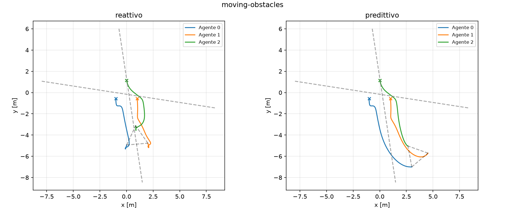
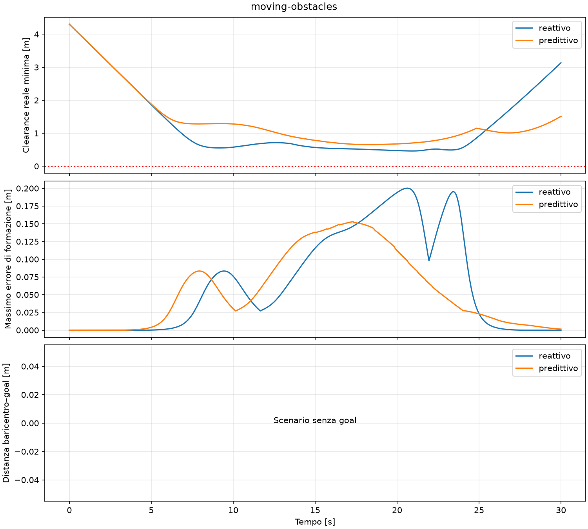
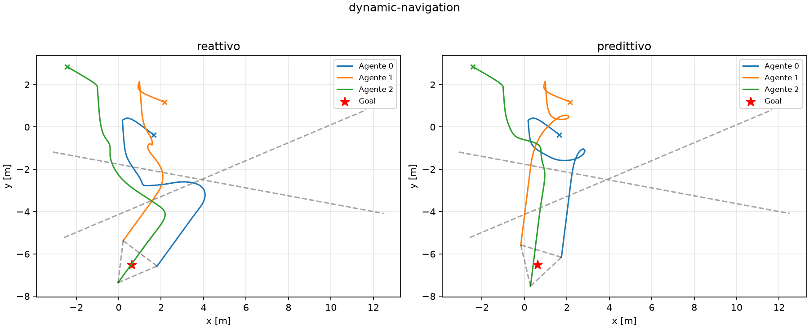
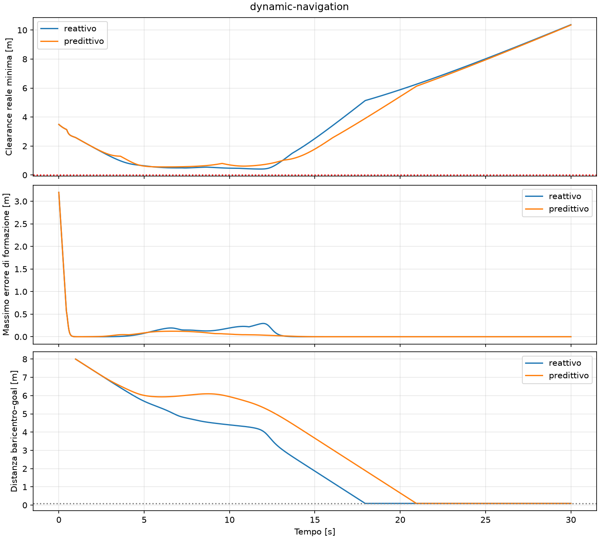

# Confronto reattivo–predittivo

Configurazione: seed `42`, N=3, 2 ostacoli, durata 30 s, dt=0.01 s, orizzonte predittivo 1.5 s, 10 campioni futuri oltre all'istante corrente.

Le posizioni iniziali degli agenti e le intere traiettorie degli ostacoli sono identiche fra i due controllori (uguaglianza verificata automaticamente). Il goal è generato all'attivazione: il suo angolo e la distanza iniziale sono identici, ma il baricentro di attivazione può differire fra le esecuzioni.

| Scenario | Controllo | Clearance minima [m] | Prima repulsione [s] | Errore formazione RMS [m] | Errore finale goal [m] | Primo arrivo [s] | Frame di contatto |
|---|---|---:|---:|---:|---:|---:|---:|
| moving-obstacles | reattivo | 0.4625 | 4.7300 | 0.0579 | — | — | 0 |
| moving-obstacles | predittivo | 0.6522 | 3.2300 | 0.0482 | — | — | 0 |
| dynamic-navigation | reattivo | 0.4134 | 1.8800 | 0.2048 | 0.0946 | 17.9500 | 0 |
| dynamic-navigation | predittivo | 0.5597 | 1.0400 | 0.1975 | 0.0942 | 20.9500 | 0 |

## moving-obstacles





## dynamic-navigation





## Interpretazione e riproducibilità

- Clearance e contatti usano le posizioni **reali**, non quelle predette.
- Un frame di contatto ha almeno una clearance non positiva; non conta eventi distinti di collisione.
- Le metriche sono campionate: non escludono collisioni tra timestep, né comprendono le collisioni agente–agente.
- Il primo arrivo non implica permanenza nel goal; `goal_reached_at_end` nel JSON indica anche il rispetto finale della tolleranza.
- Il RMS di formazione include tutti i timestep e tutti gli archi, anche la fase iniziale.
- Un singolo seed illustra un caso: non dimostra superiorità generale o garanzie di sicurezza.
- `metrics.json` contiene configurazione, versioni e indicatori; `metrics.csv` la tabella; gli altri CSV le curve e i file NPZ le traiettorie complete.

```bash
.venv/bin/python -m mas_formation.experiments.compare_avoidance \
  --seed 42 --agent-count 3 --moving-obstacle-count 2 \
  --duration 30 --dt 0.01 --prediction-horizon 1.5 \
  --prediction-steps 10 --output-dir docs/results/avoidance_comparison
```
